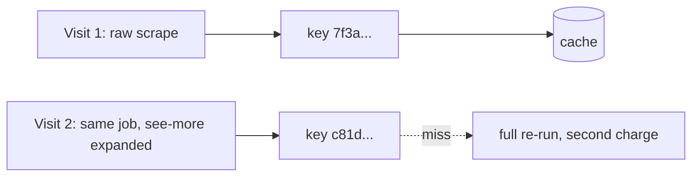
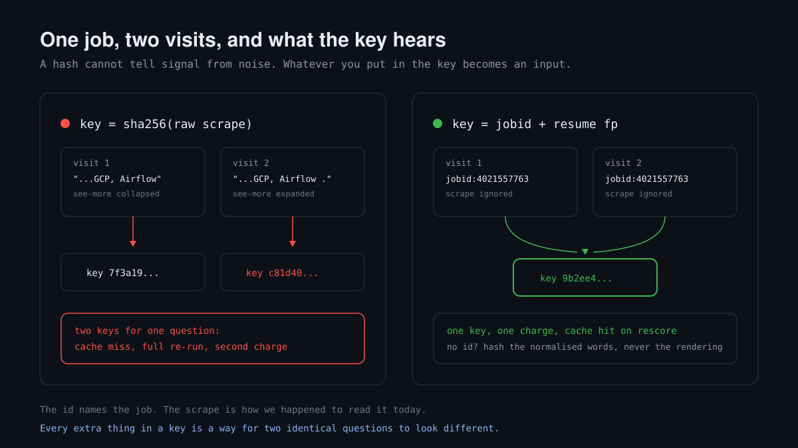

Scoring a job against a resume costs a model call, and model calls cost money. So results are cached. Score the same job with the same resume twice, and the second one should be free for both of us. The fingerprint is a SHA-256 over the inputs, a cache hit returns the stored result, no credit is charged. Simple.

The first version hashed the job text as scraped from the page. Which sounds like the inputs. It was the inputs plus a layer of noise, and the noise was in the key.

## The same job is not the same bytes

The extension reads the posting out of LinkedIn's DOM, and LinkedIn does not render a job the same way twice. Extra whitespace here, a blank line there, the "see more" section expanded on one visit and collapsed on the next, a stray character from some re-render. Same job, slightly different bytes.

A hash does not know the difference between signal and noise. Any changed byte, anywhere, and the fingerprint is new. So a user could open a job they had already scored, hit the button again, miss the cache on a whitespace change, and be charged a credit for an analysis I had already run and already stored. The answer came back identical, which made it worse: they paid twice for the privilege of being told the same thing.



Nothing in the system was malfunctioning. The cache honoured its contract exactly: different bytes, different key. The mistake was mine, in what I put into the key. A cache key should name every input the answer depends on and nothing else, and everybody remembers the first half because forgetting it causes leaks and staleness. The second half fails quietly. Every extra thing in the key is a way for two identical questions to look different, and in a system where a miss costs money, that is not a performance bug, it is a billing bug.



## Name the job, don't hash the rendering

The fix has two layers, in order of preference.

LinkedIn postings carry a stable numeric job id, and the extension sends it. When the id is present, the key ignores the scraped text entirely:

```python
def job_cache_key(job, resume_b64):
    resume_fp = sha256(resume_b64).hexdigest() if resume_b64 else "NO_RESUME"
    if job.id.isdigit():
        raw = f"jobid:{job.id}|{resume_fp}"
    else:
        raw = "|".join([
            _normalize_for_fingerprint(job.title),
            _normalize_for_fingerprint(job.company),
            _normalize_for_fingerprint(job.description),
            resume_fp,
        ])
    return sha256(raw).hexdigest()[:40]
```

The id names the job. The scrape is just how we happened to read it today, and how you read something is not an input to what it says.

When there is no id, the fallback hashes the text, but normalised first: lowercased, punctuation stripped, whitespace collapsed to single spaces. What survives is the word content, which is the part the model actually scores. The "see more" toggle and the re-render jitter melt away, and the same job maps to the same fingerprint even when the raw scrapes differ.

The resume half of the key stays byte-exact on purpose. Upload a new resume and you get a new fingerprint and a fresh score, which is not a cache miss, it is the product doing its job. You changed your CV precisely to see whether the number moves.

| Input | In the key? | Why |
| --- | --- | --- |
| LinkedIn job id | Yes, preferred | Names the job independently of rendering. |
| Scraped text | Fallback only, normalised | Word content is the input. Whitespace is not. |
| Resume fingerprint | Yes | The score is a property of the pair. |
| User id | No | Belongs on the row, not in the key. |

The user id sits outside the key deliberately, as a filter on the cache row instead. The lookup matches fingerprint *and* user, so even if two users somehow produced colliding fingerprints, neither could be served the other's result. And the cached payload has the candidate's name stripped before it is written, so the cache never holds more than it needs.

## The key is also the receipt

Here is the part that turns this from a caching post into a money post. The same fingerprint is the idempotency key for the credit charge. When a request reaches the paid path, [the atomic spend function](#post/check-then-act-race) uses this exact string to answer "has this analysis already been paid for". Cache lookup and charge deduplication are the same question asked of the same key, which is the only arrangement I trust, because it makes one fact impossible to get wrong independently: a result you already paid for cannot cost you again, and a result that costs you is one the cache genuinely did not have.

That coupling is also why the drift mattered so much. When the key wobbled, it did not just cool the cache. It punched holes in the idempotency at the same time, because "is this a duplicate charge" was being asked with a string that changed between duplicates.

Cached results expire after a day, matching the retention window on the table, so a rescore of a week-old posting is honestly fresh rather than a stale answer dressed as a hit. Within that day, identical inputs return the identical stored result, even if you press the button marked fresh. Identical inputs produce identical output. Charging you to recompute it would just be charging you.
