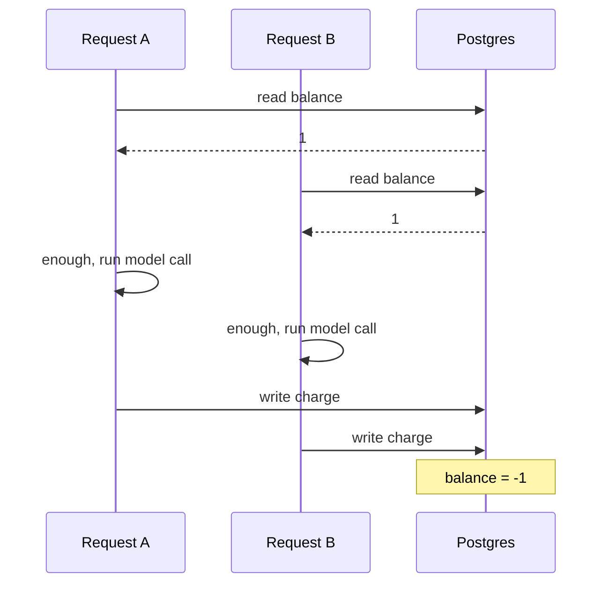
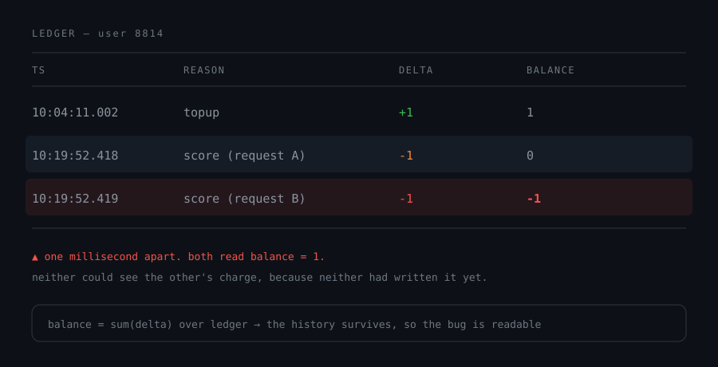

Applyin runs on credits. One scored job costs one credit, and a user with an empty balance gets nothing. That is the entire billing model, and it took me about twenty minutes to write.

The code read the balance, decided whether it was enough, then wrote the charge. Three steps, in that order. Every test I had passed, which in hindsight tells you something about my tests: they ran one request at a time.

## What actually happened

The backend sleeps on the free tier when idle, so the extension wakes it and retries with a long timeout. Which means the same analysis can arrive twice: the retry lands while the original is still running. Both requests read a balance of one. Both decided one was enough. Both ran a scoring pass against the model, which is the expensive bit. Both wrote a charge.

Balance: minus one. Two OpenAI calls billed to me, one credit collected from the user.



> Check, then act, quietly assumes nothing changes in between. Under concurrency that assumption is exactly where the money leaks out.

It is a boring bug and it is in every tutorial about transactions, which did not stop me writing it. The reason it survived review is that the window looks tiny until your own retry logic starts opening it for you. Between the balance read and the charge sat the entire analysis, which runs for many seconds. That is not a window, it is a barn door.

## What did not fix it

My first instinct was to disable the button after the first click. That is worth doing anyway, but it is not a fix, it is a decoration. The client is not where you enforce money. Anyone with the network tab open can fire the request twice, and my own retry logic could do it without any help from a user.

The second instinct was to wrap the three steps in a transaction. That does not help either, at least not at Postgres's default isolation level. Read committed will happily let both transactions read the same row and both proceed. A transaction gives you atomicity of the write. It does not stop two readers agreeing on a stale number.

| Attempt | Stops double spend? | Why |
| --- | --- | --- |
| Disable the button | No | Client-side. Trivially bypassed, and retries ignore it. |
| Wrap in a transaction | No | Read committed lets both reads see the same row. |
| `SELECT ... FOR UPDATE` | Yes | Locks a row, but the balance is a sum over many ledger rows, so there is no single row to lock. |
| Advisory lock on user | Yes | Serializes on the user id itself, no row required. |

## The fix

The read and the write had to become one indivisible step. I moved the decision into a Postgres function and took a lock keyed on the user before reading anything. Trimmed to its skeleton:

```sql
-- one lock per user. the check and the charge cannot interleave
perform pg_advisory_xact_lock(hashtext(p_user::text));

-- balance is the sum of the ledger, not a column anyone decrements
select coalesce(sum(delta), 0) into _bal
from credit_ledger where user_id = p_user;
if _bal < p_cost then
  return 'insufficient';
end if;

insert into credit_ledger (user_id, delta, reason, meta)
values (p_user, -p_cost, 'analysis',
        jsonb_build_object('idem_key', p_idem));
return 'charged';
```

The advisory lock is held until the transaction ends, so the second request blocks on the lock, wakes up after the first has committed its charge, sums the ledger to zero, and returns `insufficient`. It never reaches the model call.

Two details worth stealing. The lock is per user, not global, so two different users never wait on each other. And the balance is a view over an append-only ledger rather than a column I decrement, which means when something does go wrong I can read the history and see it, instead of staring at a single number that is simply wrong.

## The bit I nearly missed

Locking stops the double spend. It does not stop the double *charge* on a retry, which is a different problem wearing the same coat. If the request succeeds but the response is lost, the client retries, and my nice safe function charges again, correctly, for what the user experiences as one action.

So every charge carries an idempotency key, and I did not invent a new identifier for it: it is the analysis fingerprint, the same hash the cache is keyed on. Inside the lock, before checking the balance, the function sums the ledger rows carrying that key. Net negative means this exact analysis is already paid for, and the answer is `duplicate`, no charge, no model call.

Why a sum instead of a unique index on the key? Refunds. When an analysis fails after the charge, the credit is refunded as an opposite ledger row with the same key, and the two net to zero. A unique index would remember the failed attempt forever and refuse the honest retry. The net-sum forgets it, which is the behaviour you actually want: an in-flight duplicate cannot pay twice, and a refunded failure can pay again.



The lesson I would actually pass on is narrower than "learn about locks". It is that my test suite had a shape, and the shape was one-request-at-a-time, and no amount of coverage inside that shape was going to find this. The regression tests now fire concurrent requests at the handler and check the ledger, and there are two of them because the bug has two faces. Same job twice, concurrently: exactly one charge, the other deduped. Two *different* jobs, concurrently, on a single credit: exactly one charge, the other told `insufficient`.

```python
async def test_concurrent_different_jobs_respect_balance(monkeypatch):
    # One credit; two concurrent requests for DIFFERENT jobs. The atomic balance
    # check means only one can be charged - the other gets 'insufficient' (402),
    # so we never run two paid analyses on a single credit.
    await asyncio.gather(
        analyze.analyze_job(_fake_request(), _req(JD_A), user),
        analyze.analyze_job(_fake_request(), _req(JD_B), user),
        return_exceptions=True,
    )
    assert db.charges == 1
    assert INITIAL_BALANCE + db.analysis_delta == 0
```

The different-jobs case is the one a simpler fix misses. Idempotency alone dedupes retries of the same work, but two distinct jobs share nothing except the balance they are both trying to spend, and only the lock makes them take turns.
