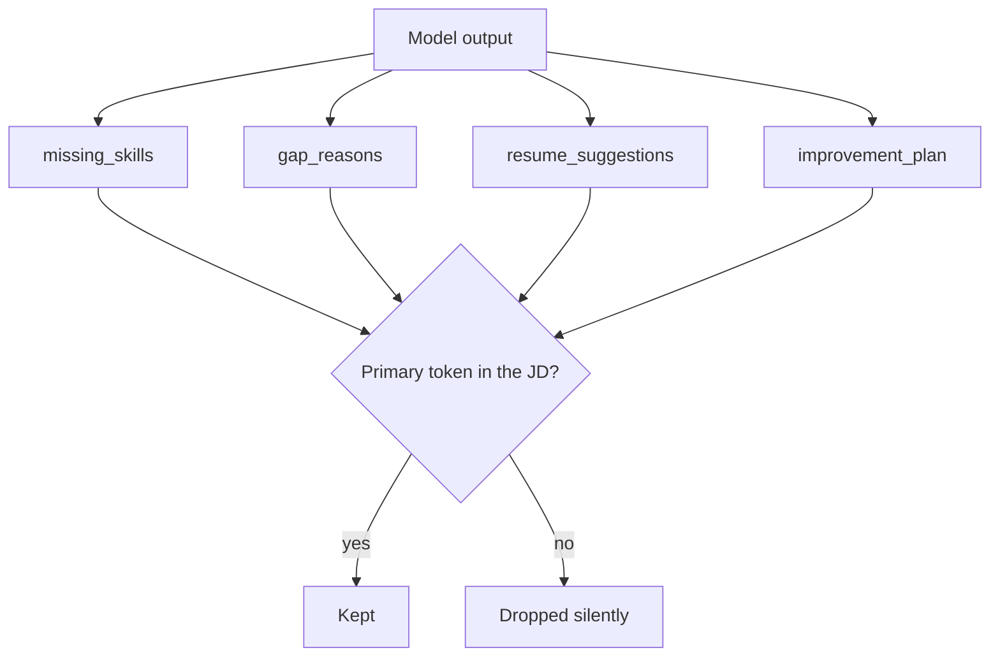
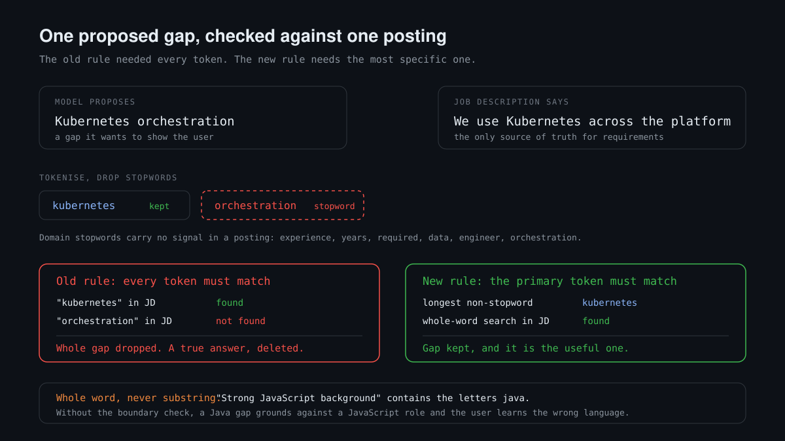

Applyin reads a job description and your resume, then tells you which requirements you do not meet. The model proposes those gaps. It is also perfectly capable of inventing them.

So every gap the model proposes has to survive a filter before anyone sees it. The rule is simple: if the skill is not written in the job description, it does not exist.

## Why the filter has to be there

A model asked to compare a resume against a posting will happily fill in what it thinks the role probably wants. Ask it about a data engineering job and it will suggest you are missing Kubernetes whether or not the posting mentions Kubernetes.

That is worse than an unhelpful answer. Someone reads "you are missing Kubernetes", believes the posting asked for it, and closes the tab on a job they could have done. The whole product is a filter on where you spend your afternoon, so a false gap sends you away from work you were qualified for.

The prompt says as much, in the bluntest terms I could write:

```text
Do NOT use outside assumptions about what "this kind of role usually needs".
Do NOT invent requirements not written in the JD.
Do NOT invent candidate experience not written in the resume.
```

Prompts are a request, not a guarantee. The filter is the guarantee.

## What it actually checks

Four separate outputs get filtered, not one: the missing skills, the gap reasons, the resume rewrite suggestions, and the improvement plan. Any of them can carry an invented requirement, so each is checked against the same predicate.



## The version that was wrong

The first cut required every token in the proposed gap to appear in the job description. It looked defensible. It quietly deleted real answers.

Say the posting reads "We use Kubernetes across the platform" and the model returns the gap "Kubernetes orchestration". Requiring every token means checking for both "kubernetes" and "orchestration". The posting never said "orchestration", so the whole gap was thrown away, including the part that was true and useful.

I only noticed because the gaps list kept coming back shorter than the score implied. A 62% fit with two listed gaps does not add up, and the missing ones were the specific, multi-word gaps, which are the ones worth reading.



## The version that works

Take the most specific token and require only that one.

```python
def _grounded_in_jd(text: str, jd_text: str, jd_requirements: list) -> bool:
    """
    True if the PRIMARY token of `text` appears as a whole word in the JD.
    """
    if not text:
        return False
    hay = (jd_text + " " + " ".join(jd_requirements)).lower()
    tokens = [t for t in re.findall(r"[a-zA-Z0-9+#.]{2,}", text.lower())
              if t not in _STOPWORDS]
    if not tokens:
        return False
    # Primary = longest token (most specific). Fall back to any token matching.
    tokens.sort(key=len, reverse=True)
    for tok in tokens:
        esc = re.escape(tok)
        if re.search(r"(?<![a-z0-9])" + esc + r"(?![a-z0-9])", hay):
            return True
    return False
```

Three things in there earn their place.

**Length as a proxy for specificity.** Sorting tokens longest first is crude and it works, because in this domain the long word is the one carrying meaning. "Kubernetes" beats "orchestration". "Terraform" beats "experience". I have not found a case where the shortest token was the one that mattered.

**Whole words, not substrings.** The lookarounds exist because of one specific failure. A posting that says "Strong JavaScript background" contains the letters `java`. Without the boundary check, a proposed gap of "Java" grounds against a JavaScript role and the user is told to learn a language nobody asked for.

**A stopword list that knows the domain.** The usual filler is in there, and so are words that are technically nouns but carry no signal in a job posting: `experience`, `years`, `required`, `skills`, `data`, `engineer`, `orchestration`, `management`. Without those, "years experience required" grounds against almost any posting and every vague gap survives.

## The one that is not about tokens

Grounding does not catch nonsense that happens to use real words. A gap of "requires 45 years of Python" is grounded, because "Python" is in the posting, and it is still absurd. That gets its own check:

```python
def _sane_experience_gap(g: str) -> bool:
    m = re.search(r"(\d{1,3})\s*\+?\s*years?", g.lower())
    return not (m and int(m.group(1)) > 20)
```

Twenty years is arbitrary. It is high enough that a real senior posting passes and low enough to catch a model that has lost track of the decade.

## What I would tell someone building the same thing

Write the tests before you touch the money path. I locked these down in `test_grounding.py` immediately before refactoring how credits are charged, precisely because grounding is the kind of logic a refactor loosens by accident. Nothing about a billing change should alter which gaps survive, and now nothing can without a test going red.

The tests read like the bugs, which is the point:

```python
def test_whole_word_match_not_substring():
    assert _grounded_in_jd("Java", "Strong JavaScript background", []) is False
    assert _grounded_in_jd("Java", "Strong Java background", []) is True
```

The wider lesson is that a filter against hallucination is itself a classifier, and it has both error modes. I spent all my early attention on precision, because an invented requirement is the visible, embarrassing failure. The recall side cost more. A filter that silently deletes true answers looks like a model that had nothing to say, and you will not notice it until the output feels thin and you cannot explain why.

Dropped items are still dropped silently. If I rebuild this, the filter logs what it removed and why, so the next time the list looks short I can read the reason instead of guessing.
