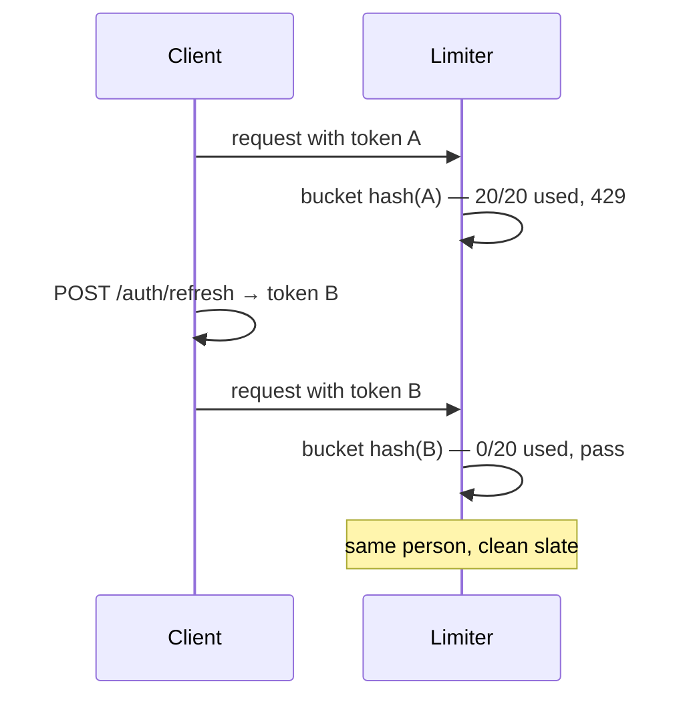
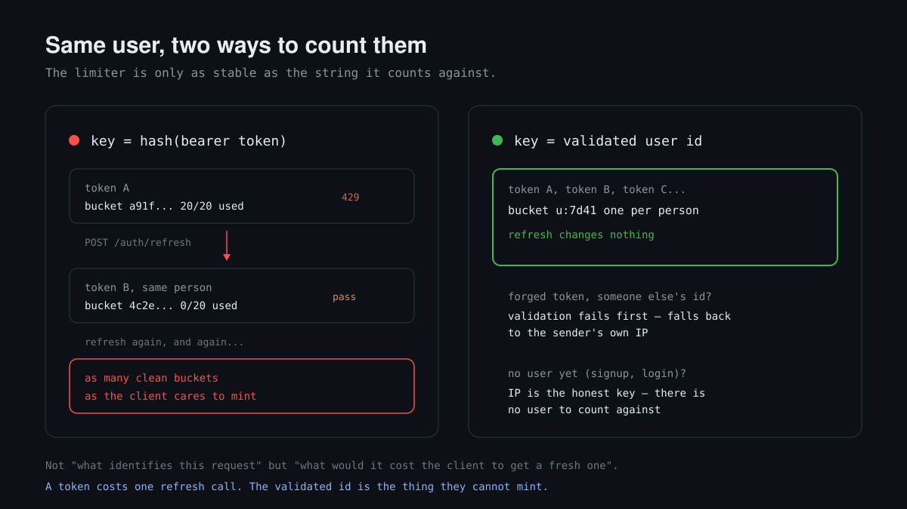

Every write-up about rate limiting spends its time on the algorithm. Token bucket, leaky bucket, sliding window. I read several, picked slowapi's sliding window, put 20 requests a minute on the scoring endpoint and 3 a minute on signup, and considered the problem handled.

The algorithm was never the problem. The key was.

## "Per user" is a phrase, not a key

A limiter needs a string to count against, and the obvious string in an authenticated request is the bearer token. My first version hashed the token and used that. It reads as "per user", it keeps the limiter out of the business of parsing auth, and it puts no personal data in the bucket key. One tidy line.

A token is not a user. Sessions refresh, and when they refresh, the access token rotates. New token, new hash, new bucket, zero requests used. My extension's service worker refreshes the session automatically, which means the client was quietly resetting its own rate limit as a side effect of staying logged in. A client doing it on purpose would not even need to be clever, because the refresh endpoint hands out fresh tokens on request.

So the limit said "20 a minute per user" and enforced "20 a minute per token, and tokens are free."



There was no incident behind this one. Nobody was hammering the API, and with a handful of users nobody was likely to. It is the kind of bug that costs nothing right up until it is the only thing that matters.



## Key on the thing the client cannot mint

The fix is to count against the validated user id, which the auth layer has already extracted by the time the limiter runs. The comment on the fix says most of what this post says, which is deliberate, because the next person to touch this file is me in six months:

```python
def _user_or_ip(request):
    """Rate-limit per authenticated user when possible, else per IP.

    Keys on the VALIDATED user id (set on request.state by get_current_user) so the
    limit is stable across token refreshes - the old approach hashed the bearer
    token, which rotates on refresh, letting a user reset their bucket by refreshing.
    A forged token never reaches this with a user id set (validation fails first),
    so it can't be used to key against, or grief, a real user."""
    uid = getattr(getattr(request, "state", None), "user_id", None)
    if uid:
        return "u:" + str(uid)
    return get_remote_address(request)
```

Two properties earn their place. The id only lands on `request.state` after the token validates, so you cannot fill a stranger's bucket by sending garbage with their user id in it; garbage fails validation and falls through to your own IP. And the IP fallback is not a shrug, it is the correct key for the routes that need limiting most, because signup, login and refresh happen before there is any user to count against.

The regression test is three lines and it states the requirement better than the ticket did:

```python
def test_same_user_same_key_across_token_refresh():
    # Two requests from the same user (different tokens, same validated id) must
    # map to the SAME limiter bucket - the whole point of the fix.
    r1 = types.SimpleNamespace(state=types.SimpleNamespace(user_id="u1"))
    r2 = types.SimpleNamespace(state=types.SimpleNamespace(user_id="u1"))
    assert _user_or_ip(r1) == _user_or_ip(r2)
```

## Signup is the same bug in different clothes

Once you start asking "what can the client mint", signup gets uncomfortable, because signup gives away three free credits and the identifier it hangs them on is an email address. An email address is about as mintable as an identifier gets. `me+1@gmail.com`, `me+2@gmail.com`, and Gmail ignores dots, so `m.e@gmail.com` is the same inbox again.

The defence is layered, and each layer is small:

- The bonus is keyed on a canonical form of the email, not the address as typed. `+alias` is stripped for every provider, dots are stripped for the Gmail family only, and the canonical form is used purely for de-duplication, never for login.
- Known disposable domains are refused at signup outright.
- The database holds the real line: a partial unique index allows exactly one `signup_bonus` ledger row per user, so if two grant attempts race, one insert wins and the other is treated as already-granted. The application code checks first, but the index is why a race is boring instead of expensive.

The pattern across both halves is the same question. Not "what identifies this request", but "what would it cost the client to get a fresh one of these". A token costs one call to refresh. An email alias costs nothing. A validated account costs a signup flow with the aliases collapsed out of it, which is not much, but it is no longer free, and the ledger index means even free only pays out once.

## What this still does not do

Everything above is fairness between identities. None of it caps the total. If I am wrong in some way I have not thought of yet, there is no global ceiling on model calls across the whole service to make the worst case a survivable bill, and that is the missing layer I am least comfortable about. It is not written yet, so unlike everything else in this post, I cannot show it to you.
