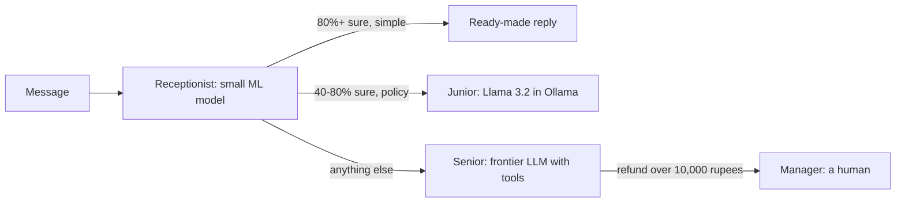

Agent on a Budget is the project behind my upGrad masterclass on building AI agents, October 2026. It builds a customer support agent with tools, then makes it cheaper and faster without making it worse.

## The idea

Most agents send every message to the biggest model available. That is easy to build and expensive to run, and most messages do not need it. "Where is my order NM10009" is not a reasoning problem.

So the project treats support like an office with four people in it, and each message stops at the cheapest one who can answer.

## The LLM teaches the small model

The receptionist is a classic ML classifier. The frontier model labels 1,080 example messages once, for about seven cents, and the classifier learns from those labels. After that it reads every incoming message in about 0.05 ms, with no model call.

## Safety lives in code

Two rules override confidence: anything that changes money or an order always goes to the senior model, and order questions never go to the junior. Refund limits and cancellation windows are checked in Python, not in the prompt, so the model cannot talk its way past them.

## Measured

On 60 test messages with a mini frontier model:

| | Expert alone | Whole office |
|---|---|---|
| Cost per 1,000 messages | $0.99 | $0.52 |
| Average wait | 1.70 s | 1.04 s |
| Answered for $0 | 0% | 55% |

When the receptionist is at least 80% sure it takes 72% of messages, and 98.3% of those are right.

## For the room

Seven notebooks, a Streamlit app and 55 tests that use fake LLMs, so everything runs offline and free. Saved answers replay without an API key, which matters when a workshop's Wi-Fi does not cooperate.
