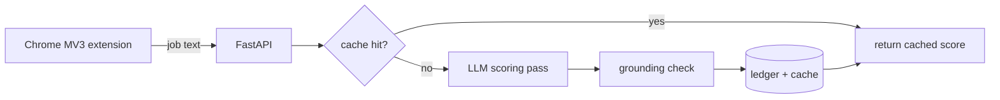
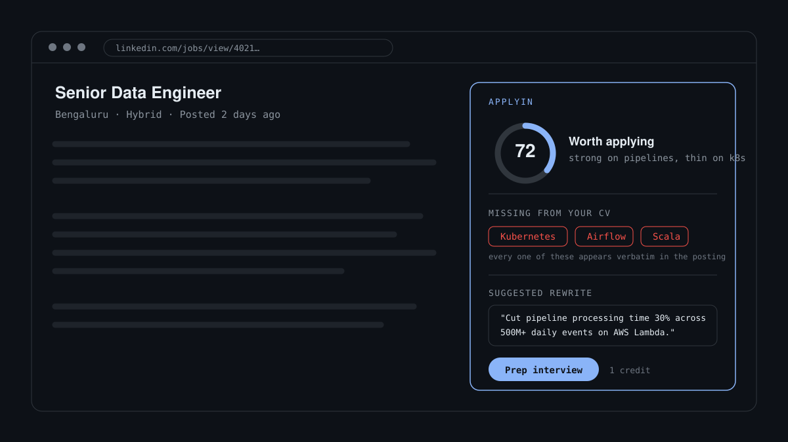

You are on a LinkedIn job page. Applyin opens in a sidebar next to it and answers one question: is this worth your afternoon?

It gives you a fit score against your actual resume, the specific skills the posting wants that your CV does not mention, a rewritten version of the relevant bullets, and a short interview prep sheet for that role.

The source is private because it is a paid product with a live payment integration. This page is the write-up instead.

## Why I built it

I spent a week applying to jobs I had no business applying to. The posting says eight years of Kubernetes, I have none, and I find that out forty minutes into tailoring a CV. The signal I wanted was cheap to compute and nobody was showing it to me at the moment I needed it, which is while I am looking at the posting.

## How it fits together

The extension scrapes the posting from the DOM rather than calling the LinkedIn API, which does not offer this. The backend does the scoring, holds the credit ledger, and owns every decision that involves money.

## The parts I would show an interviewer

**The credit ledger is append-only.** Balance is a view over a sum of ledger rows, not a column I decrement. When something goes wrong I can read the history instead of staring at one number that is simply wrong. Writing about [the race condition that made this necessary](#post/check-then-act-race) is probably the most useful thing on this site.

**Spending a credit is atomic and idempotent.** A per-user advisory lock makes the check and the charge one indivisible step, and the analysis fingerprint doubles as the idempotency key, so a retried request is deduplicated instead of charged twice — while a refunded failure is allowed to pay again.

**Scoring is deterministic where it can be.** The model produces a structured judgement, but the arithmetic that turns it into a score is ordinary code. Same inputs, same number, every time. A model that returns a slightly different 78 each time you ask is not a score, it is a mood.

**Grounding checks.** Before a "missing skill" is shown, it has to appear in the job text. Without that check the model cheerfully invents requirements, and a tool that invents requirements is worse than no tool, because it sends you away from jobs you could do.

| Concern | Where it lives | Why there |
| --- | --- | --- |
| Scraping the posting | Extension | Only the browser has the rendered page. |
| Scoring | Backend | Keys stay server-side, and results are cacheable. |
| Money | Postgres | The only place I can make it atomic. |
| Caching | Backend | Keyed on the job's identity plus a resume fingerprint, not the raw scrape. |

## What is not done

It has a handful of users, not a business. The resume parser handles clean PDFs and gives up on the two-column designs people love. There is no evaluation harness for scoring quality yet, which is the honest gap: I can tell you the score is stable, not that it is right.

Next is an eval set of postings I have judged by hand, so changes to the prompt can be measured instead of eyeballed.
