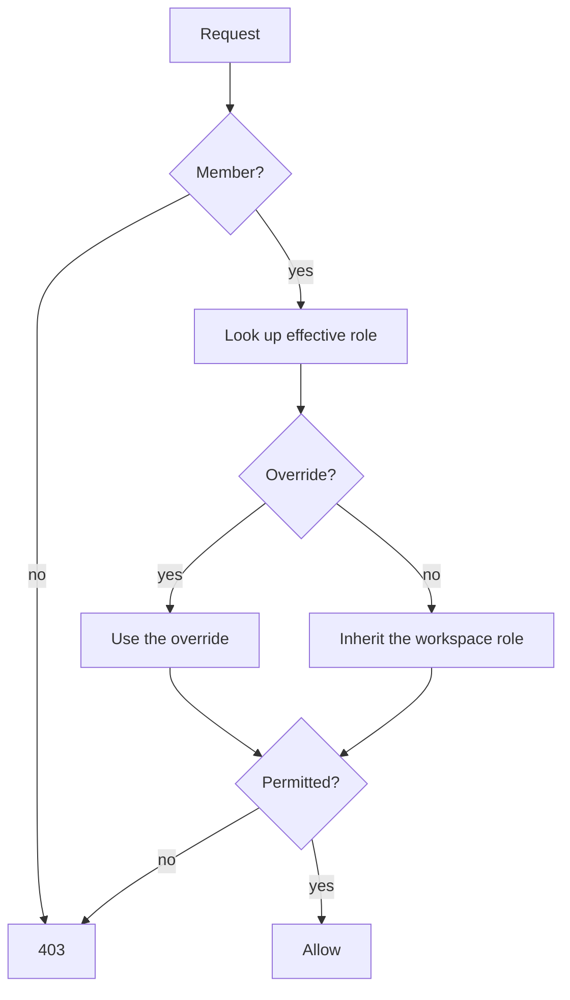
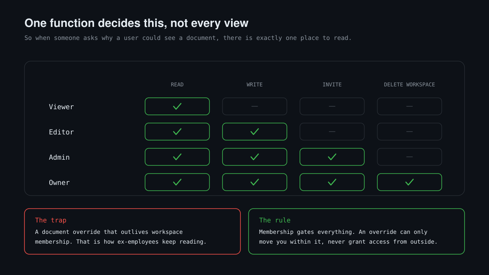

CollabDocs is a backend API for workspaces, documents and team permissions. Django and Django REST Framework, PostgreSQL underneath.

There is no editor. That is deliberate.

## What I was actually practising

Collaborative editing is a solved and very deep problem, and building a mediocre CRDT would have taught me less than getting the boring part right. The boring part is permissions, and permissions are where these systems leak.

The question I wanted to answer properly: when someone opens a document, what exactly decides whether they may read it, and can I express that in one place rather than sprinkling `if user.is_admin` through every view?

Roles resolve at the workspace level and can be overridden per document. Effective permission is computed in one function that every endpoint calls, so there is exactly one place to read when someone asks why a user could see something.

| Role | Read | Write | Invite | Delete workspace |
| --- | --- | --- | --- | --- |
| Viewer | Yes | No | No | No |
| Editor | Yes | Yes | No | No |
| Admin | Yes | Yes | Yes | No |
| Owner | Yes | Yes | Yes | Yes |

## Things that turned out to be less obvious than expected

Removing someone from a workspace has to consider documents where they hold an explicit override. The tidy answer is that workspace membership gates everything and an override can only narrow or widen within it, never grant access to someone who is not a member. Getting that wrong is how ex-employees keep reading your documents.

Soft deletes and permissions interact badly. A deleted document that still appears in a permission check is a slow leak, so deletion filters at the queryset level rather than in each view.
