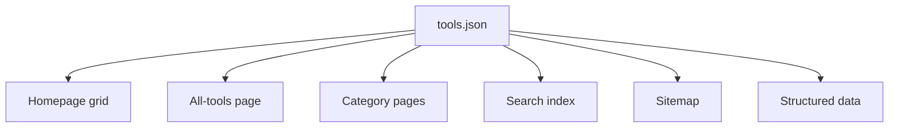

NoByte is 63 small tools and 13 games that run in your browser. QR codes, PDF surgery, a JSON formatter, a contrast checker, Minesweeper. You open a page, it does the one thing, and almost nothing you type ever leaves the tab. Live at [nobyte.in](https://nobyte.in).

## The idea

It started at work, with a README. I wanted to drop in a table, check a contrast ratio for a badge, tidy a blob of JSON someone had pasted into a ticket. Small jobs, all of them, and every tool I found online wanted an upload, an account, or a cookie banner before it would do thirty seconds of work. None of it was hard. All of it was in the way.

And it was not just me. The people I worked with had the same set of half-trusted bookmarks for the same small tasks, reached for out of habit and never quite believed. Nobody complained, because each one was too trivial to be worth the breath. Which is how a pain everybody feels goes unfixed: no single instance is ever big enough to name, so it never lands on anyone's list. That is what changed my mind. If a whole team was quietly working around the same friction, the fix was not a better bookmark. It was to build the thing once, do it properly, and leave it somewhere anyone could use without signing away something to get in.

So NoByte began as the handful of tools I wanted at my own desk, the README builder chief among them, and grew outward from there. The rule was simple: if a browser can do the job on its own, it does, and nothing goes to a server. Only two tools break that rule, a DNS lookup and a dictionary, because a DNS query has to ask a resolver and a definition has to come from somewhere. Both say so on the page rather than quietly reaching out.

## No dependencies, and I mean none

The builder, the dev server and the tests use only the Node standard library. There is nothing to `npm install`, nothing to audit, and no supply chain to worry about. The third-party browser libraries the heavier tools need, pdf.js and pdf-lib and marked and a few others, are vendored and pinned in one folder, never pulled from a CDN while someone is using the site.

That was a deliberate cost. Vendoring means I own every update, and a CDN would have been less to carry. But a tool that promises your data stays on your machine cannot then load code from someone else's on every visit.

## One registry runs the whole thing

There is a single file, `tools.json`, that lists every tool. The homepage grid, the all-tools page, each category page, the on-site search, the sitemap and the per-tool structured data are all generated from it. Nothing is wired by hand, so nothing drifts out of sync. Adding a tool is an entry in that file, one page, and one script, and it appears everywhere at once.

## Pure core, DOM shell

The parts worth trusting live in small modules with no DOM in them at all: the Lights Out solver, the WCAG contrast maths, a BigInt base parser. Each tool file is a thin wrapper that reads the inputs off the page and calls into one of them.

The split is not for tidiness. It is what lets the hard bits run under `node --test` with no browser, so I can prove the contrast checker says black on white is exactly 21 to 1 before I trust the colour of a warning.

## What it does not do

Two tools that people search for constantly are missing on purpose. A speed test, because a browser cannot measure a fast connection honestly. A live currency converter, because the free rate feeds update once a day and would show a number that looks live and is not.

> Both would have brought traffic. Neither would have told the truth, so neither shipped.

That line, what a tool can honestly claim from inside a browser, decided more of the project than any feature did.
