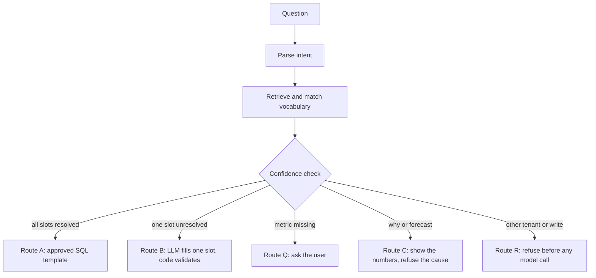

Retrieval as a Guardrail is the reference code for my talk at the upGrad AI Marathon in Bengaluru, September 2026. It is an NL-to-SQL assistant that retrieves before it generates, so it can tell the difference between a question it can answer exactly and one it should not answer at all.

## The problem

An NL-to-SQL assistant has one failure that matters more than the rest: it is silently wrong. The model writes a query that parses, runs and returns a number. The number is wrong because it picked the wrong column or invented a business rule, and nothing on the screen says so.

Better prompts do not fix that. What fixes it is taking the decision away from the model wherever the decision can be made in code.

## Retrieve, then decide

Every question is matched against a canonical vocabulary with a BM25 ranker before any SQL exists. The match has to clear a score of 0.60 and beat the runner-up by at least 0.10. What happens next depends on how complete that match is.

Route A is the one I want most questions to take: a parameterised template, zero LLM tokens, an answer you can audit. Route B lets the model fill exactly one gap, an odd date or an alias, and the code checks the result against the schema before it runs. If the model is not confident it falls through to Route C rather than guessing.

## What the audience ran

The repo has a terminal CLI, a small web UI and a hands-on guide, all over a single-seller slice of a public e-commerce dataset in SQLite. Without an API key it still works, because most routes never call a model.

## What I took from it

The interesting design work is not in the prompt. It is in deciding which questions deserve a model at all, and making the refusals as useful as the answers.
