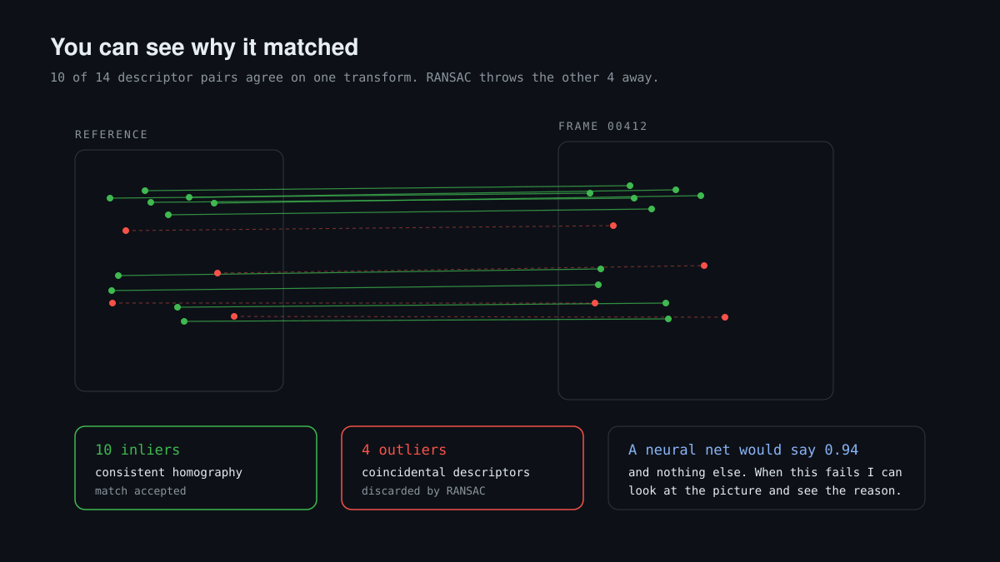
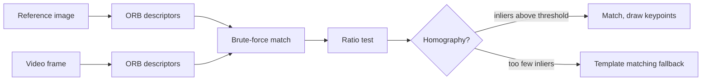

SkopeLabs scans a video file or a live camera feed looking for a reference image you give it, and when it finds one it shows you the matched keypoints that made the decision.

It uses classical feature matching, ORB descriptors with a RANSAC homography check, and falls back to template matching when there is not enough texture to work with. No neural network.

## Why classical, in 2026

Because I wanted to be able to argue with it.

A fine-tuned detector would probably beat this on raw accuracy. It would also tell me "0.94" and nothing else. When it fails, and it will, I have no way to interrogate the failure except to collect more data and retrain, which is a long feedback loop for a tool I wanted to trust.

ORB and RANSAC give a decision I can look at. The keypoints are drawn on the frame. If it matched the wrong thing, I can see that it locked onto a repeating pattern in the background, and I can do something about it that same afternoon.

> Explainability is not only an ethics concern. It is a debugging speed concern, and on a small project debugging speed is the whole budget.

## How the matching works

The ratio test throws out ambiguous matches before geometry is considered. RANSAC then asks whether the surviving matches agree on a single plausible transform, which is what stops a scatter of coincidental descriptor matches from counting as a detection.

| Stage | Rejects | Cost |
| --- | --- | --- |
| ORB extraction | Nothing | Cheap, runs per frame |
| Ratio test | Ambiguous descriptor pairs | Negligible |
| RANSAC | Geometrically incoherent matches | The expensive step |
| Template fallback | Used only when ORB finds too little texture | Slow, so it is last |

## Where it struggles

Flat, untextured objects. ORB needs corners, and a plain white box has almost none, which is exactly when the template fallback earns its place. Heavy motion blur also destroys descriptors, so a fast pan produces a gap in detections that looks like a bug and is really physics.
