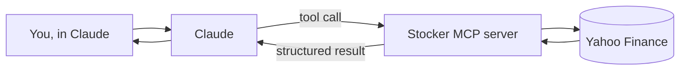
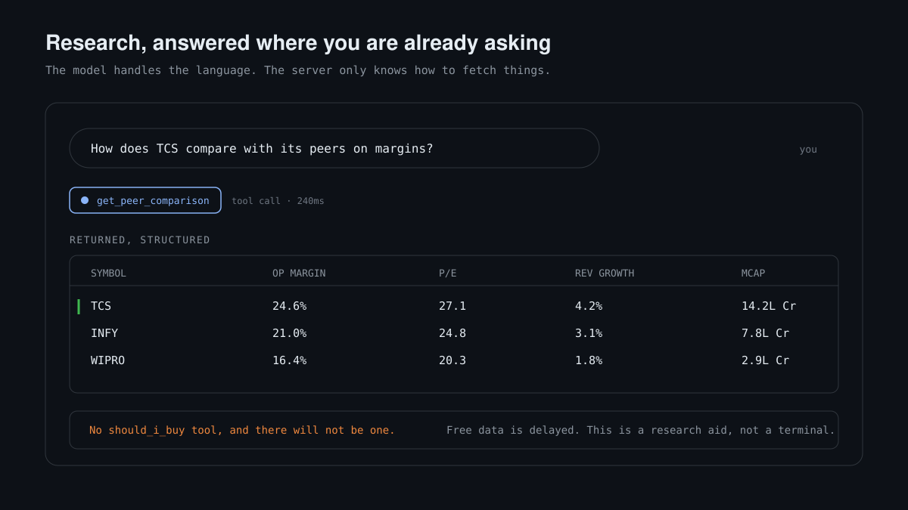

Stocker is an MCP server that puts NSE stock research inside Claude. You ask a question in ordinary language and it fetches quotes, screens the market, compares a stock against its peers, or manages a watchlist, all off free Yahoo Finance data.

## The idea

I kept doing the same loop by hand: open a screener, filter, copy a few tickers into another tab, compare them, write down what I found. Every step was mechanical and none of it needed me.

MCP is the right shape for this because the model does not need to know how to fetch a quote, it needs to know that fetching a quote is possible. The server exposes the capability, the model handles the language and the sequencing.

## What it exposes

- Quotes and price history for NSE symbols
- A screener with the filters I actually use, rather than every filter that exists
- Peer comparison, so a valuation number has something to sit next to
- Watchlists, with alerts on price and diversification
- Upcoming events, so a result does not surprise you

## The design decision worth mentioning

Every tool returns structured data and refuses to editorialise. There is no `should_i_buy` tool, and there will not be one.

Partly that is a line I do not want to cross with something that touches other people's money. Mostly it is that the moment a tool starts returning judgements, the model starts laundering them as facts, and you lose the ability to tell which part of the answer came from data and which came from a prompt I wrote at midnight.

> Free data has real limits. Yahoo's numbers are delayed, occasionally wrong, and not something to trade against. This is a research aid, not a terminal.

## Not done

Fundamentals coverage for smaller NSE listings is patchy, which is a data source problem rather than a code problem. Switching to a paid feed would fix it and would also make the thing I built impossible to hand to someone else for free, so it stays as it is for now.
