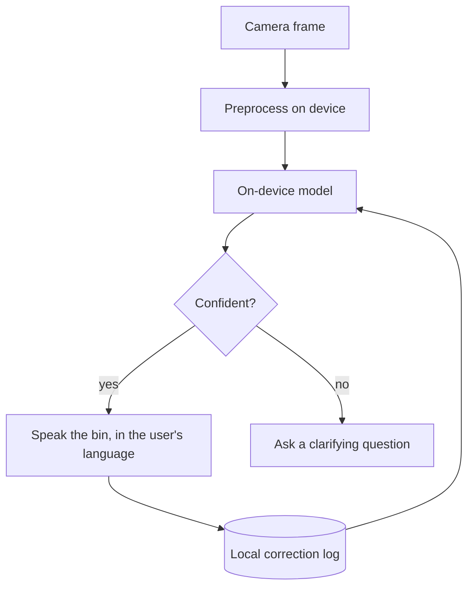
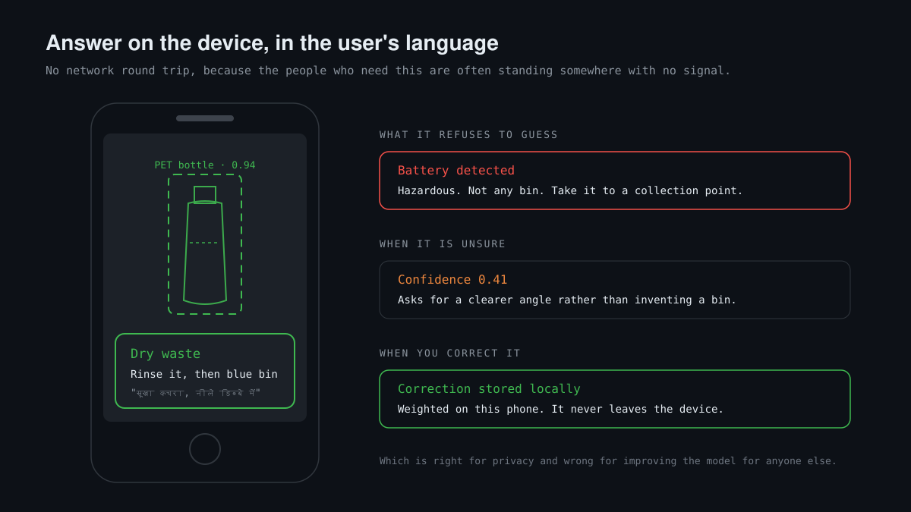

Sutham points a phone camera at a piece of rubbish and tells you which bin it belongs in, following the segregation rules Bengaluru's civic body actually publishes. It reasons about what the item is made of rather than just naming it, and it runs entirely on the device.

I built it solo in 6.5 hours at the Google DeepMind hackathon, after being selected as one of 250 from more than four thousand applicants. I did not make the winners' list.

## The constraint that shaped everything

Waste sorting advice is useless if it arrives late or not at all. The people who most need it are often standing in a kitchen with bad signal, and the answer has to be immediate. So the model runs on the phone.

That ruled out the easy version, which is to send a photo to an API and render the reply. Everything after that decision was a consequence of it.

## What six and a half hours bought

- Live classification from the camera, reasoning about material composition rather than matching a label
- Disposal guidance mapped to the BBMP segregation rules, so the answer is the one Bengaluru actually enforces
- Spoken conversation in English, Hindi, Kannada, Tamil and Telugu through Gemini Live, because reading a screen while holding rubbish is awkward
- Clarifying questions when the model is unsure, instead of a confident guess
- Corrections stored on the device and weighted over time
- E-waste and hazardous items redirected to collection points rather than any bin

## What it does not do

It is a hackathon build, and the seams show. The correction log never leaves the phone, which is right for privacy and useless for improving anyone else's copy of the app. Confidence thresholds were tuned by hand against whatever was within reach of my desk that afternoon, not against a held-out set.

I would rather ship the honest version and say what it cannot do than demo the version that only works on the three objects I tested.
