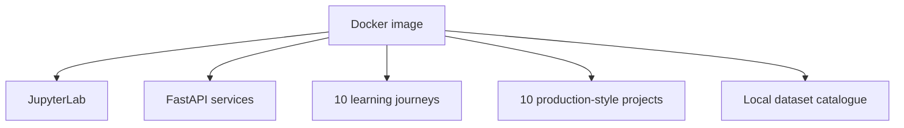

TensorBox is a machine learning and AI engineering workstation in one Docker image. Pull it, start it, and JupyterLab, the libraries, the datasets and the exercises are already there. It is on [Docker Hub](https://hub.docker.com/r/ankitsurana/tensorbox) and open on GitHub.

## Why

Every cohort I have seen loses its first week to setup: Python versions, CUDA, a library that will not build on one laptop. The learning has not started and people are already behind. I wanted one command that gives everyone the same working machine.

## What is inside



**Learning journeys.** Ten notebooks that go from a Titanic decision tree to churn with asymmetric costs, anomaly detection, clustering, Q-learning, NLP and a two-tower recommender, ending with RAG and tool-calling agents. Each one explains the maths step by step and saves a model you can reuse.

**Projects.** Ten end-to-end builds with their own services and tests: a hybrid BM25 plus dense RAG search engine with reciprocal rank fusion, a streaming fraud feature store, a multi-agent market analyst, a continuous-training pipeline with drift detection, a LoRA serving hub and more.

## How it is built

A pinned `requirements.txt` compiled from `requirements.in`, a Dockerfile and a docker-compose file for the supporting services, a dependency-conflict check and test suite that run in CI on every push and every Monday, and a script that executes every notebook end to end. A dependency bump that breaks a lesson should fail there, not in front of a student.

## Run it

```bash
docker-compose up -d --build
# JupyterLab at http://localhost:8888
```
